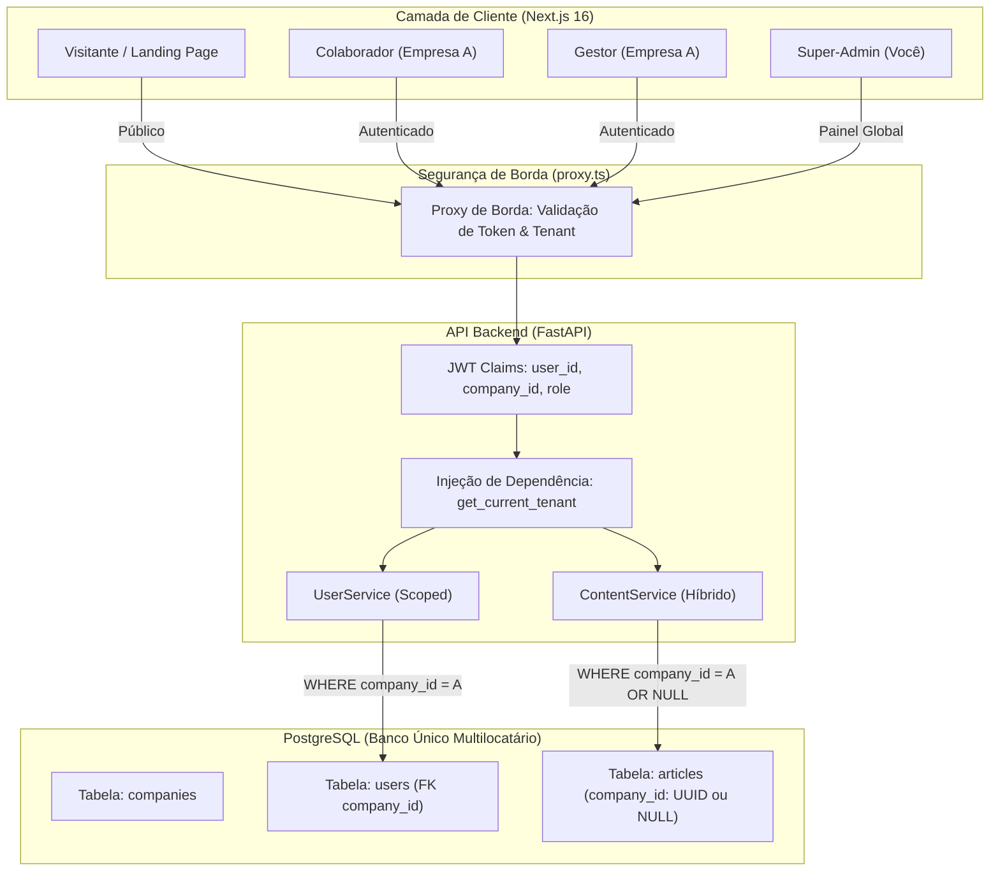

# ROADMAP: TRANSFORMAÇÃO MULTI-TENANT B2B (SAAS)
**Projeto:** Base de Conhecimento / SST SaaS  
**Versão:** 1.0  
**Data:** 24 de Outubro de 2026  
**Status:** Proposta de Arquitetura e Engenharia de Produto  

---

## 1. Visão Executiva e Estratégia de Negócio

### 1.1. O Problema Atual
Atualmente, o projeto funciona como uma aplicação mono-inquilino (single-tenant):
1. **Artigos acoplados ao Git:** Todo o acervo vive em arquivos Markdown físicos (`apps/web/src/content/artigos/`) compilados no momento do build (`generate-catalog.js`). Se uma empresa cliente quiser criar ou alterar um procedimento interno, isso exigiria um commit e um novo deploy da aplicação.
2. **Sem isolamento de dados:** Os usuários no banco (`models/user.py`) não possuem vínculo com uma organização ou empresa específica.
3. **Impossibilidade de escala comercial:** Para atender 10 clientes corporativos diferentes no modelo atual, seria necessário subir e manter 10 servidores e 10 bancos de dados separados.

### 1.2. A Solução: Arquitetura Multi-Tenant com Isolamento Lógico (Row-Level)
Transformar a aplicação em um **SaaS B2B Multilocatário**, onde uma única infraestrutura compartilhada (FastAPI + PostgreSQL + Next.js) atende dezenas de empresas clientes com **isolamento absoluto de dados**, reduzindo o custo operacional e viabilizando a venda por assinatura recorrente.

### 1.3. O Grande Diferencial Competitivo (Modelo Híbrido de Conteúdo)
* **Biblioteca Oficial Inclusa (Conteúdo Global):** O acervo técnico já produzido sobre SST, eSocial, NRs, PGR e LTCAT não é descartado. Ele se torna o **maior atrativo de vendas** do SaaS. O cliente já contrata o sistema "populado" com centenas de diretrizes práticas prontas.
* **Procedimentos Próprios da Empresa (Conteúdo Privado):** Editores da empresa contratante podem criar fluxos internos, scripts de atendimento e manuais corporativos que ficam visíveis **apenas** para os colaboradores daquela organização.

---

## 2. Visão Geral da Arquitetura



---

## 3. As 4 Fases do Roadmap

---

### FASE 1: Fundação da Entidade Tenant e Isolamento no Backend
**Objetivo:** Adaptar o banco de dados e a autenticação para que todas as ações e consultas sejam filtradas por empresa.  
**Estimativa:** 1 a 2 semanas  
**Foco:** `apps/api/backend`

#### Tarefas de Engenharia:
1. **Migration Alembic para Criação da Tabela `companies`:**
   ```sql
   CREATE TABLE companies (
       id UUID PRIMARY KEY DEFAULT gen_random_uuid(),
       name VARCHAR(150) NOT NULL,
       slug VARCHAR(100) UNIQUE NOT NULL,
       cnpj VARCHAR(20) UNIQUE,
       plan VARCHAR(30) NOT NULL DEFAULT 'starter', -- starter, pro, enterprise
       max_users INT NOT NULL DEFAULT 10,
       is_active BOOLEAN NOT NULL DEFAULT TRUE,
       created_at TIMESTAMP WITH TIME ZONE DEFAULT NOW()
   );
   ```
2. **Vínculo na Tabela de Usuários (`models/user.py`):**
   * Adicionar coluna `company_id` (`UUID`, ForeignKey referenciando `companies.id`, indexada).
   * Criar via migration a empresa "Matriz / Demonstração" para vincular automaticamente os usuários existentes no banco.
3. **Novo Nível de RBAC Multi-nível (`models/user.py` e `core/tokens.py`):**
   * `super_admin`: Dono do SaaS (você e seu sócio). Pode cadastrar empresas e gerenciar planos.
   * `company_admin`: Gestor da empresa contratante. Pode criar usuários, resetar senhas da sua equipe e aprovar editores.
   * `editor`: Colaborador que pode redigir, editar e publicar artigos da empresa dele.
   * `user`: Colaborador comum com permissão estrita de leitura.
4. **Injeção de Claims no JWT (`services/auth_service.py`):**
   * Incluir `company_id` e o `slug` da empresa no payload do token assinado EdDSA (Ed25519).
5. **Dependência de Tenant no FastAPI (`dependencies/dependencies.py`):**
   * Criar a dependência `get_current_tenant`:
     * Extrai e valida o `company_id` do usuário logado.
     * Verifica se a empresa está ativa (`is_active == True`). Se estiver inativa (inadimplência ou suspensão), bloqueia a requisição com código `403 Forbidden`.
     * Repassa o escopo de tenant para os repositórios (`UserRepository`, `SessionRepository`).

---

### FASE 2: Migração do Acervo para o Banco (Modelo Híbrido de Conteúdo)
**Objetivo:** Tirar os artigos dos arquivos Markdown do Git e levá-los para o banco relacional com suporte a conteúdos globais e privados.  
**Estimativa:** 2 semanas  
**Foco:** `models/content.py`, `services/content_service.py`, `api/content_routes.py`

#### Tarefas de Engenharia:
1. **Tabela `articles` no PostgreSQL (`models/content.py`):**
   ```sql
   CREATE TABLE articles (
       id VARCHAR(150) NOT NULL, -- slug/id legível
       company_id UUID REFERENCES companies(id) ON DELETE CASCADE, -- NULL = Global
       title VARCHAR(250) NOT NULL,
       summary TEXT NOT NULL,
       content_markdown TEXT NOT NULL,
       category VARCHAR(50) NOT NULL,
       tags JSONB DEFAULT '[]'::jsonb,
       author_id UUID REFERENCES users(id) ON DELETE SET NULL,
       validity_months INT DEFAULT 12,
       last_reviewed_at TIMESTAMP WITH TIME ZONE DEFAULT NOW(),
       created_at TIMESTAMP WITH TIME ZONE DEFAULT NOW(),
       PRIMARY KEY (id, company_id) -- Permite mesmo slug em empresas diferentes
   );
   CREATE INDEX idx_articles_tenant ON articles(company_id);
   ```
2. **Script de Carga Inicial (Seed dos Artigos Atuais):**
   * Criar script Python (`apps/api/backend/scripts/seed_global_articles.py`) que percorre todos os arquivos `.md` de `apps/web/src/content/artigos/` e faz o insert no PostgreSQL com `company_id = NULL`.
3. **Endpoints de Conteúdo com Isolamento Lógico (`content_routes.py`):**
   * `GET /content/articles`:
     * Executa query: `WHERE company_id = :current_company_id OR company_id IS NULL`.
     * Retorna a lista unificada de artigos globais + artigos privados da empresa.
   * `GET /content/articles/{id}`:
     * Busca o artigo respeitando o mesmo isolamento de tenant.
   * `POST /content/articles`:
     * Permissão: `roles=['editor', 'company_admin', 'super_admin']`.
     * Salva o artigo forçando `company_id = current_user.company_id`.
   * `PUT /content/articles/{id}` e `DELETE /content/articles/{id}`:
     * Garante que um editor só possa alterar ou excluir artigos pertencentes à sua própria empresa (proibindo edição direta de artigos globais por clientes).

---

### FASE 3: Adaptação do Frontend Multi-Tenant (`apps/web`)
**Objetivo:** Fazer o Next.js consumir a API autenticada em tempo real, eliminando a dependência do `catalog.json` estático e mantendo a interface rápida.  
**Estimativa:** 1 a 2 semanas  
**Foco:** `apps/web/src/features/`

#### Tarefas de Engenharia:
1. **Integração Real do `ArticleEditor.tsx`:**
   * Conectar o formulário existente de edição ao endpoint `POST /content/articles` e `PUT /content/articles/{id}`.
   * Publicação imediata: ao salvar, o artigo já fica disponível para os colegas de trabalho sem necessidade de rebuild da aplicação.
2. **Catálogo Dinâmico e Busca no Cliente:**
   * Atualizar `HomeGrid.tsx` e `CommandPalette.tsx` para carregar a listagem via endpoint autenticado `/content/articles` com cache no cliente.
   * A busca instantânea do MiniSearch continuará rodando com latência zero no navegador, mas agora indexando os artigos específicos daquela empresa logada.
3. **Escopo na Gestão de Usuários (`UsersManager.tsx`):**
   * O `company_admin` visualiza e cadastra apenas colaboradores com o mesmo `company_id`.
   * Bloqueio visual para impedir que ele cadastre usuários além do limite contratado (`max_users`).
4. **Isolamento de Borda no `src/proxy.ts`:**
   * O proxy já implementado valida a presença do cookie e direciona o usuário para o seu ambiente logado ou para a landing page institucional caso não autenticado.

---

### FASE 4: Painel do Dono do SaaS (`/super-admin`) e Comercialização
**Objetivo:** Criar as ferramentas administrativas internas para criar empresas, gerenciar planos e faturar clientes.  
**Estimativa:** 1 semana  
**Foco:** `apps/web/src/app/admin/super` e automações de faturamento

#### Tarefas de Engenharia:
1. **Página de Gestão de Clientes (`/admin/empresas` ou `/super-admin`):**
   * Restrita exclusivamente ao papel `super_admin`.
   * Tabela com todas as empresas contratantes: Nome, CNPJ, Plano, Contagem de usuários ativos / Limite, Status (`Ativo` / `Suspenso`).
   * Ação de onboarding:
     * Botão "Cadastrar Nova Empresa".
     * Cria a empresa e o primeiro usuário gestor (`company_admin`).
     * Dispara automaticamente o e-mail transacional com o link de primeiro acesso e senha temporária.
2. **Personalização Visual por Empresa (White-Label Básico):**
   * Permitir que a empresa cadastre seu logotipo e nome fantasia nas configurações da conta.
   * O cabeçalho exibe: `[Logo da Empresa] powered by Base SST`.
3. **Bloqueio de Inadimplência:**
   * Ação rápida com 1 clique para inativar uma empresa (`is_active = False`), impedindo acessos de toda a organização caso a assinatura expire.

---

## 4. Matriz de Argumentação para Alinhamento com o Colega

| Dúvida / Objeção Técnica | Resposta Estratégica & Técnica |
| :--- | :--- |
| *"Teremos que reescrever todo o frontend?"* | **Não.** Quase 90% das telas já estão prontas (`ArticleEditor`, `UsersManager`, `RoleRequestsManager`, `HomeGrid`). Elas só passarão a enviar dados para os endpoints da API em vez de ler arquivos estáticos locais. |
| *"E todo o trabalho que tivemos escrevendo os artigos atuais?"* | **Ele se torna o nosso maior ativo comercial.** A maioria das plataformas de base de conhecimento (Notion, Zendesk, GitBook) é vendida vazia. Nós venderemos uma central já abastecida com a biblioteca oficial de SST/eSocial pronta. |
| *"O banco de dados aguenta múltiplas empresas juntas?"* | **Com folga.** O isolamento lógico por `company_id` com índices no PostgreSQL suporta facilmente centenas de empresas e milhões de linhas em uma máquina modesta, sem a complexidade de gerenciar múltiplos bancos. |
| *"Como evitamos que uma empresa veja dados de outra por acidente?"* | Através de **Row-Level Isolation** garantido pela dependência centralizada `get_current_tenant` no FastAPI e claims criptografadas no JWT. Nenhum endpoint responde dados sem filtrar pela empresa autenticada. |

---

## 5. Próximos Passos Imediatos (Checklist de Ação)

- [ ] Validar a proposta de modelo de dados com a equipe.
- [ ] Definir a lista de planos comerciais iniciais (ex: *Start* = até 10 usuários; *Pro* = até 50 usuários + procedimentos privados; *Enterprise* = usuários ilimitados + suporte dedicado).
- [ ] Iniciar a **Fase 1**: criar migration Alembic com a tabela `companies` e vincular `company_id` à tabela `users`.
